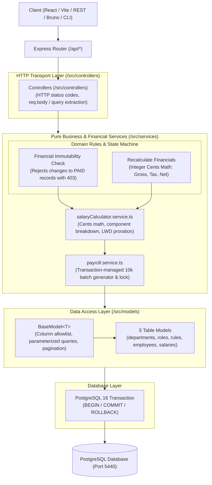

# Backend Architectural Design Document (v2.0)
## ACME Salary Management System (SMS)

---

### 1. Executive Summary & Core Architectural Tenets

The **ACME Salary Management System (SMS)** backend manages compensation for **10,000 employees** across **12 global departments**. 

Following senior architectural review, the system adheres to **four non-negotiable financial and engineering principles**:

1. **Domain-Centric Business Logic:** Financial locking (`checkNotPaid`) and mathematical recalculations (`recalculateTotals`) live **exclusively inside domain services**, not in HTTP route middlewares. This guarantees that business rules execute consistently whether invoked by REST endpoints, CLI scripts, cron jobs, or automated unit tests.
2. **ACID Transaction Atomicity:** The 10,000-employee payroll generation and payday disbursements are strictly wrapped in database transactions (`BEGIN` ... `COMMIT` / `ROLLBACK`). If chunk #7 fails, all previous chunks are rolled back, preventing orphaned or partial payroll cycles.
3. **Strict Column Allowlists:** `BaseModel<T>` enforces compile-time and runtime column allowlists for all `WHERE`, `ORDER BY`, and `ILIKE` operations, preventing SQL injection or exposure of arbitrary database columns.
4. **Zero Float Math in Financial Operations:** Monetary calculations eliminate JavaScript IEEE-754 floating-point precision errors ($0.1 + 0.2 = 0.30000000000000004$) by conducting all monetary calculations using **integer cents** with deterministic half-up rounding, matching Stripe/FinTech standards.

---

### 2. Architectural Flow Diagram



---

### 3. Key Architecture Enhancements

#### A. Domain Services Own Business & Locking Rules
* **Previous Flaw:** Putting `checkNotPaid` or `recalculateTotals` in Express middleware hooks coupled critical business logic to HTTP routes.
* **New Design:** 
  * `payroll.service.ts` and `salaryCalculator.service.ts` directly enforce rules:
    ```typescript
    // Inside domain service - NOT in Express middleware
    if (existingRecord.status === 'PAID') {
      const err = new Error('Cannot modify a finalized and paid payroll record');
      err.name = 'FinancialLockError';
      err.statusCode = 403;
      throw err;
    }
    ```
  * Controllers simply catch this error and return `403 Forbidden`.
  * Unit tests and background jobs execute the exact same business logic without requiring mock HTTP requests.

---

#### B. ACID Database Transactions for 10k Batch Payroll
* The 10,000-employee payroll generation runs inside an explicit transaction:
  ```typescript
  const client = await pool.connect();
  try {
    await client.query('BEGIN');
    
    // Process in 10 chunks of 1,000 employees
    for (let i = 0; i < chunks.length; i++) {
      await batchInsertChunk(client, chunks[i]);
    }
    
    await client.query('COMMIT');
  } catch (error) {
    await client.query('ROLLBACK');
    throw error;
  } finally {
    client.release();
  }
  ```
* **Guarantee:** If chunk #7 fails (e.g. database timeout or constraint collision), the entire transaction rolls back cleanly. Zero corrupt half-state.

---

#### C. Column Allowlists in `BaseModel` (SQL Injection Protection)
* To prevent attackers from passing arbitrary SQL snippets into dynamic `ORDER BY` or `WHERE` clauses, each model explicitly registers its permitted columns:
  ```typescript
  export class DepartmentModel extends BaseModel<Department> {
    constructor() {
      super('departments', 'id', [
        'id',
        'department_id',
        'name',
        'created_at'
      ]);
    }
  }
  ```
* `BaseModel` validates every requested filter key, sort column, and search target against `allowedColumns`. Any unapproved column is strictly rejected.

---

#### D. Integer Cents Currency Math (Zero Float Drift)
* Financial calculations convert all USD currency inputs into **integer cents** ($1.00 = 100\text{ cents}$) before applying formulas:
  ```typescript
  // Convert dollars to integer cents
  const toCents = (dollars: number): number => Math.round(dollars * 100);
  const toDollars = (cents: number): number => Number((cents / 100).toFixed(2));

  // Pure integer cents arithmetic
  const monthlyCtcCents = Math.round(annualCtcCents / 12);
  const baseSalaryCents = Math.round((monthlyCtcCents * basePct) / 100);
  const allowanceCents = Math.round((monthlyCtcCents * allowancePct) / 100);
  const bonusCents = Math.round((monthlyCtcCents * bonusPct) / 100);
  
  const grossCents = baseSalaryCents + allowanceCents + bonusCents;
  const taxCents = Math.round((grossCents * taxPct) / 100);
  const netCents = grossCents - taxCents;
  ```
* **Guarantee:** Zero floating point rounding drift ($0.1 + 0.2 = 0.30000000000000004$) across 10,000 monthly disbursement totals.

---

### 5. Loophole Resolution & Enterprise Financial Safeguards

Based on our architectural audit, the following safeguards are formally integrated into the system:

#### A. Loophole 1: Idempotency & Concurrent Double-Generation
* **Challenge:** Two HR managers clicking "Generate Payroll" at the same instant could trigger race conditions or unique constraint crashes.
* **Resolution:**
  1. Database enforces `UNIQUE (employee_id, payout_year, payout_month)`.
  2. The generation routine uses **Upsert semantics (`ON CONFLICT (employee_id, payout_year, payout_month) DO UPDATE ...`)** if the cycle is in `DRAFT` mode.
  3. If the cycle is already `PAID`, the service immediately aborts before running queries.
  4. Payroll generation is **100% idempotent**—triggering it multiple times produces identical, collision-free results.

---

#### B. Loophole 2: Exact Component Reconciliation (The "Cent Drift" Guard)
* **Challenge:** Independent rounding of percentages (e.g. $100 / 3 = 33.33$) can cause component sums to drift from Gross by $\pm 1$ cent.
* **Resolution:**
  * Component parts (`base`, `allowance`, `bonus`) are computed in integer cents.
  * Gross and Net are computed via strict reconciliation:
    $$\text{gross\_cents} = \text{base\_cents} + \text{allowance\_cents} + \text{bonus\_cents}$$
    $$\text{net\_cents} = \text{gross\_cents} - \text{tax\_deduction\_cents}$$
  * This guarantees that in every payslip and database row:
    $$\mathbf{\text{Gross}} \equiv \mathbf{\text{Base}} + \mathbf{\text{Allowance}} + \mathbf{\text{Bonus}}$$
    $$\mathbf{\text{Net}} \equiv \mathbf{\text{Gross}} - \mathbf{\text{Tax Deduction}}$$

---

#### C. Loophole 3: Historical Audit Freezing (Snapshot Immutability)
* **Challenge:** If compensation rules in `salary_component_rules` are modified in the future (e.g., bonus raised from 15% to 20%), past payslips must not retroactively change.
* **Resolution:**
  * The `calculation_snapshot JSONB` column stores the complete point-in-time calculation state: applied rule percentages, gross/tax/net breakdown, employee metadata, and proration details.
  * Payslip preview, reporting, and settlement views **strictly read from `calculation_snapshot`**, never dynamically re-querying `salary_component_rules` for historical cycles. Past statements remain immutable forever.

---

#### D. Loophole 5: Dynamic Calendar Month Proration (February & 30/31 Day Accuracy)
* **Challenge:** Hardcoding 30 days for all months leads to inaccurate LWD settlements in February (28/29 days) and 31-day months (January, March, May, July, August, October, December).
* **Resolution:**
  * Total days in month are calculated dynamically via standard calendar arithmetic:
    ```typescript
    const totalDaysInMonth = new Date(year, month, 0).getDate();
    ```
  * Days worked is derived from `last_working_day`. Proration is exact down to the calendar day for any month or leap year.

---

#### E. Loophole 4: Connection Pool Management During 10k Batch Runs
* *Status:* Reserved for dedicated architectural review and benchmarking prior to deployment.

---

### 6. Summary of Architecture Directory Structure

```
sms-backend/src/
├── config/
│   ├── db.ts                          # PostgreSQL pool & transaction helper
│   └── schema.sql                     # Schema DDL
│
├── types/
│   └── index.ts                       # TypeScript interfaces
│
├── utils/
│   └── currency.ts                    # Integer cents currency math utilities
│
├── models/                            # Data Access Layer with Column Allowlists
│   ├── base.model.ts                  # Generic typed BaseModel with SQL injection guards
│   ├── departments.model.ts
│   ├── roles.model.ts
│   ├── salary_component_rules.model.ts
│   ├── employee_details.model.ts
│   └── employee_salary_details.model.ts
│
├── services/                          # Domain Logic & Transaction Orchestrator
│   ├── salaryCalculator.service.ts    # Integer cents math & LWD proration
│   └── payroll.service.ts             # ACID transaction 10k batch generator & locking rules
│
├── controllers/                       # HTTP Layer (Clean mapping to HTTP responses)
│   ├── departments.controller.ts
│   ├── roles.controller.ts
│   ├── rules.controller.ts
│   ├── employees.controller.ts
│   └── salaries.controller.ts
│
├── routes/
│   └── index.ts
│
└── server.ts
```

