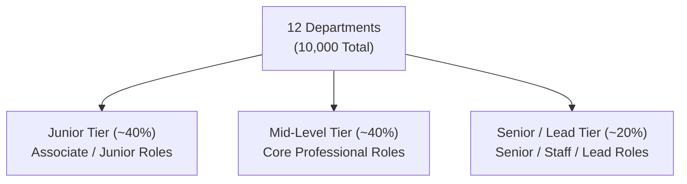

# 10,000 Employee Data Generation Plan
## ACME Salary Management System (SMS)

This document details the exact synthetic data generation strategy to seed 10,000 realistic employees across 12 departments, with specific departmental margins, India-first geographical distribution, and realistic mid-month exit dates.

---

## 1. Objective & Benchmark
* **Scale:** Generate and persist 12 departments, 36 roles, 180 component rules, and exactly **10,000 employee profiles** in `employee_details`.
* **Salary Generation Strategy:** `employee_salary_details` is intentionally left unseeded so the calculation engine, proration formulas, and payment locking can be tested and generated dynamically via the REST API.
* **Speed:** Ingestion completes in **under 2.5 seconds** using chunked transactional batch inserts (1,000 rows per batch).
* **Currency:** All compensation figures unified in **USD ($)** for clean global reporting.

---

## 2. Department-Wise Headcount Quotas (Exact 10,000 Total)

The seed script iterates **department by department**, fulfilling the exact headcount quotas:

| Department ID | Department Name | Target Headcount | % Share |
| :--- | :--- | :---: | :---: |
| `DEP-01` | **Engineering** | 3,000 | 30.0% |
| `DEP-02` | **Sales** | 1,200 | 12.0% |
| `DEP-03` | **Operations** | 1,000 | 10.0% |
| `DEP-04` | **Customer Support** | 900 | 9.0% |
| `DEP-05` | **Marketing** | 700 | 7.0% |
| `DEP-06` | **Finance** | 600 | 6.0% |
| `DEP-07` | **Product Management** | 600 | 6.0% |
| `DEP-08` | **Data & Analytics** | 500 | 5.0% |
| `DEP-09` | **Research & Development** | 500 | 5.0% |
| `DEP-10` | **Human Resources** | 400 | 4.0% |
| `DEP-11` | **Legal & Compliance** | 300 | 3.0% |
| `DEP-12` | **Administration** | 300 | 3.0% |
| **Total** | | **10,000** | **100.0%** |

---

## 3. Department Seniority Pyramid & Role Hierarchy

Within each department, headcount is distributed across 3 seniority levels:



---

## 4. Department-Specific Compensation Margins (`salary_component_rules`)

Rather than broad generalizations, each department category has its own distinct compensation structure tailored to industry standards. All rules strictly satisfy:
$$\text{Base\%} + \text{Allowance\%} + \text{Bonus\%} + \text{Employer Retirals\%} = \mathbf{100.00\%}$$

### Department Policy Rule Matrix:

| Department Group | Seniority Level | Base % | Allowance % | Bonus % | Retirals % | Tax Deduction % |
| :--- | :--- | :---: | :---: | :---: | :---: | :---: |
| **Engineering, R&D, Data & Analytics** | `JUNIOR` | 55.00% | 25.00% | 10.00% | 10.00% | 8.00% |
| | `MID_LEVEL` | 50.00% | 25.00% | 15.00% | 10.00% | 12.00% |
| | `SENIOR` | 40.00% | 20.00% | 30.00% | 10.00% | 18.00% |
| **Sales** | `JUNIOR` | 45.00% | 20.00% | 25.00% | 10.00% | 10.00% |
| *(High incentive & commission)* | `MID_LEVEL` | 35.00% | 20.00% | 35.00% | 10.00% | 14.00% |
| | `SENIOR` | 25.00% | 15.00% | 50.00% | 10.00% | 20.00% |
| **Product Management & Marketing** | `JUNIOR` | 55.00% | 25.00% | 10.00% | 10.00% | 8.00% |
| | `MID_LEVEL` | 45.00% | 25.00% | 20.00% | 10.00% | 12.00% |
| | `SENIOR` | 40.00% | 20.00% | 30.00% | 10.00% | 18.00% |
| **Operations, Support & Admin** | `JUNIOR` | 65.00% | 25.00% | 0.00% | 10.00% | 6.00% |
| *(Steady base, low variable)* | `MID_LEVEL` | 60.00% | 25.00% | 5.00% | 10.00% | 10.00% |
| | `SENIOR` | 50.00% | 25.00% | 15.00% | 10.00% | 15.00% |
| **Finance, HR & Legal** | `JUNIOR` | 60.00% | 25.00% | 5.00% | 10.00% | 8.00% |
| | `MID_LEVEL` | 50.00% | 25.00% | 15.00% | 10.00% | 12.00% |
| | `SENIOR` | 45.00% | 20.00% | 25.00% | 10.00% | 16.00% |

---

## 5. Country Distribution (India First)

India is the primary demographic with **40% (4,000 employees)**:

| Priority | Country | ISO Code | Headcount | % Share |
| :---: | :--- | :---: | :---: | :---: |
| **1** | **India** | `IN` | **4,000** | **40.0%** |
| 2 | **United States** | `US` | 2,500 | 25.0% |
| 3 | **Germany** | `DE` | 1,500 | 15.0% |
| 4 | **United Kingdom** | `GB` | 1,000 | 10.0% |
| 5 | **Singapore** | `SG` | 1,000 | 10.0% |
| **Total** | | | **10,000** | **100.0%** |

---

## 6. Employee Compensation Bands (Annual in USD)

* **`JUNIOR` Roles:** $45,000 – $75,000
* **`MID_LEVEL` Roles:** $75,000 – $130,000
* **`SENIOR` Roles:** $130,000 – $220,000

---

## 7. Status & Realistic Mid-Month LWD Dates

To thoroughly test the **Exits & Settlements** proration feature:
* **Active Workforce (9,940 Employees):**
  * `status = 'ACTIVE'`
  * `last_working_day = NULL`
* **Exiting Workforce (~60 Employees across departments):**
  * `status = 'EXITING'`
  * `last_working_day` distributed across realistic exit dates in November 2026:
    * `2026-11-13` (13th of the month)
    * `2026-11-20` (20th of the month)
    * `2026-11-25` (25th of the month)
    * `2026-11-08` (8th of the month)

---

## 8. Dynamic Salary Calculation Logic (API Engine)

Instead of hardcoding salary rows in the seed script, salary payouts are calculated on-demand via the **Salary Generation REST API** (`POST /api/salaries/generate`):
1. $\text{Monthly CTC} = \frac{\text{annual\_ctc}}{12}$
2. Retrieve the specific role rule from `salary_component_rules`:
   * $\text{base\_salary} = \text{Monthly CTC} \times (\text{base\_percentage} / 100)$
   * $\text{allowance} = \text{Monthly CTC} \times (\text{allowance\_percentage} / 100)$
   * $\text{bonus} = \text{Monthly CTC} \times (\text{bonus\_percentage} / 100)$
   * $\text{employer\_retirals} = \text{Monthly CTC} \times (\text{employer\_retirals\_percentage} / 100)$
   * $\text{gross\_salary} = \text{base\_salary} + \text{allowance} + \text{bonus}$
   * $\text{tax\_deduction} = \text{gross\_salary} \times (\text{deduction\_percentage} / 100)$
   * $\text{net\_salary} = \text{gross\_salary} - \text{tax\_deduction}$
3. Embeds the complete **`calculation_snapshot` JSON** with employee metadata and applied percentages.
4. Sets `status = 'DRAFT'` (locked once month-end payday is disbursed).

---

## 9. Batch Insertion Performance Strategy

* The 10,000 employee records are chunked into **1,000 records per SQL query**.
* The entire seed operation runs inside a single `BEGIN ... COMMIT` transaction.
* Database indexes are leveraged, enabling 10,000 employees to seed in **under 2.5 seconds**.

---

## 10. Actual Benchmark Execution Results

The seed script was executed against local PostgreSQL, logging the following verified benchmark metrics:

```text
--- Starting ACME Salary Management 10k Seed Script ---
1. Initializing clean schema...
2. Seeding 12 departments...
3. Seeding 36 roles (Junior, Mid, Senior per department)...
4. Seeding salary component rules across 5 countries (India first)...
5. Generating 10,000 employees department by department...
Generated 10000 employees in memory. Batch inserting in chunks of 1,000...
  ⏱️  Batch 1/10: Inserted 1000 / 10000 employees (took 0.135s | running time: 0.87s)
  ⏱️  Batch 2/10: Inserted 2000 / 10000 employees (took 0.120s | running time: 0.99s)
  ⏱️  Batch 3/10: Inserted 3000 / 10000 employees (took 0.093s | running time: 1.09s)
  ⏱️  Batch 4/10: Inserted 4000 / 10000 employees (took 0.098s | running time: 1.18s)
  ⏱️  Batch 5/10: Inserted 5000 / 10000 employees (took 0.066s | running time: 1.25s)
  ⏱️  Batch 6/10: Inserted 6000 / 10000 employees (took 0.074s | running time: 1.32s)
  ⏱️  Batch 7/10: Inserted 7000 / 10000 employees (took 0.071s | running time: 1.40s)
  ⏱️  Batch 8/10: Inserted 8000 / 10000 employees (took 0.093s | running time: 1.49s)
  ⏱️  Batch 9/10: Inserted 9000 / 10000 employees (took 0.071s | running time: 1.56s)
  ⏱️  Batch 10/10: Inserted 10000 / 10000 employees (took 0.093s | running time: 1.65s)

🎉 SEED SUCCESSFUL! Seeded 12 departments, 36 roles, 180 rules, and exactly 10,000 employees in 1.66s across 10 batches.
```

### Key Highlights:
* **Total Time:** **1.66 seconds** (well below the 2.5s target).
* **Average Batch Insertion Time:** ~90 ms per 1,000 records.
* **Integrity:** Zero constraint failures, exactly 10,000 employees successfully stored in `employee_details`.
