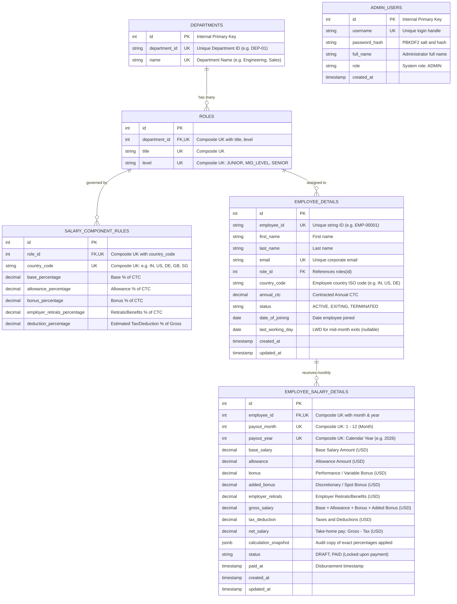

# Entity Relationship (ER) Diagram
## ACME Salary Management System (SMS)

This document details the normalized relational database architecture designed in PostgreSQL for the ACME Salary Management System.

---

### 1. Visual ER Diagram (Mermaid)



---

### 2. Table Dictionaries & Schema Design

#### A. `departments`
* **Purpose:** Stores the 12 organizational departments for ACME org.
* **Columns:**
  * `id` (`SERIAL PRIMARY KEY`): Auto-incrementing internal primary key.
  * `department_id` (`VARCHAR(30) UNIQUE NOT NULL`): Unique department identifier (e.g., `DEP-01`, `DEP-02`).
  * `name` (`VARCHAR(100) UNIQUE NOT NULL`): Unique department name (e.g., Engineering, Sales, Operations, Marketing, Finance).

#### B. `roles`
* **Purpose:** Defines job titles and seniority levels categorized under each department.
* **Columns:**
  * `id` (`SERIAL PRIMARY KEY`): Unique role identifier.
  * `department_id` (`INT NOT NULL REFERENCES departments(id)`): Owning department primary key.
  * `title` (`VARCHAR(100) NOT NULL`): Official role title (e.g., "Software Engineer", "Sales Executive").
  * `level` (`VARCHAR(20) NOT NULL`): Seniority tier: `'JUNIOR'`, `'MID_LEVEL'`, or `'SENIOR'`.
  * **Constraint:** `UNIQUE(department_id, title, level)` ensures clean, non-duplicate roles.

#### C. `salary_component_rules`
* **Purpose:** Stores compensation policy margins and component percentages in the database per role and country (no hardcoding in code).
* **Columns:**
  * `id` (`SERIAL PRIMARY KEY`): Unique rule identifier.
  * `role_id` (`INT NOT NULL REFERENCES roles(id)`): Role to which this rule applies.
  * `country_code` (`VARCHAR(10) NOT NULL`): Country ISO code (e.g., "IN", "US", "DE", "GB", "SG").
  * `base_percentage` (`NUMERIC(5, 2)`): Base salary share of CTC.
  * `allowance_percentage` (`NUMERIC(5, 2)`): Standard allowances share of CTC.
  * `bonus_percentage` (`NUMERIC(5, 2)`): Performance/incentive bonus share of CTC.
  * `employer_retirals_percentage` (`NUMERIC(5, 2)`): Employer benefits/retirals share of CTC.
  * `deduction_percentage` (`NUMERIC(5, 2)`): Tax and statutory deduction estimate (0% - 50%).
  * **Constraints:**
    * `UNIQUE(role_id, country_code)`: Instant 1-step primary lookups.
    * `CHECK(base + allowance + bonus + retirals = 100.00)`: Guarantees CTC components sum to exactly 100%.
    * `CHECK(deduction BETWEEN 0 AND 50)`: Validates reasonable deduction bounds.

#### D. `employee_details`
* **Purpose:** Stores the master demographic and employment data for 10,000 employees.
* **Columns:**
  * `id` (`SERIAL PRIMARY KEY`): Internal auto-incrementing ID.
  * `employee_id` (`VARCHAR(30) UNIQUE NOT NULL`): Public corporate ID (e.g., "EMP-00001").
  * `first_name`, `last_name`: Employee name.
  * `email` (`VARCHAR(150) UNIQUE NOT NULL`): Corporate email.
  * `role_id` (`INT NOT NULL REFERENCES roles(id)`): Foreign key linking the employee to their role, department, and seniority level in one step.
  * `country_code` (`VARCHAR(10) NOT NULL`): Country ISO code of employment.
  * `annual_ctc` (`NUMERIC(14, 2) NOT NULL`): Contracted annual CTC.
  * `status` (`VARCHAR(20) NOT NULL`): Employment status (`'ACTIVE'`, `'EXITING'`, `'TERMINATED'`).
  * `date_of_joining` (`DATE NOT NULL`): Onboarding date.
  * `last_working_day` (`DATE NULL`): Optional exit date used for mid-month proration.

#### E. `employee_salary_details`
* **Purpose:** Materialized monthly compensation payout snapshot for each employee in USD.
* **Columns:**
  * `id` (`SERIAL PRIMARY KEY`): Unique record ID.
  * `employee_id` (`INT NOT NULL REFERENCES employee_details(id)`): Foreign key linking to the employee primary key.
  * `payout_month` (`INT NOT NULL CHECK (payout_month BETWEEN 1 AND 12)`): Pay cycle month.
  * `payout_year` (`INT NOT NULL`): Pay cycle year (e.g. 2026).
  * `base_salary`, `allowance`, `bonus`: Monthly earnings breakdown governed by policy rules (USD).
  * `added_bonus` (`NUMERIC(14, 2) NOT NULL DEFAULT 0.00`): Discretionary spot bonus or manual compensation override distinct from contractual policy bonus.
  * `employer_retirals` (`NUMERIC(14, 2) NOT NULL DEFAULT 0.00`): Employer benefits/retirals contribution.
  * `gross_salary` (`NUMERIC(14, 2) NOT NULL`): `Base + Allowance + Bonus + Added Bonus`.
  * `tax_deduction` (`NUMERIC(14, 2) NOT NULL`): Statutory tax and deduction amount.
  * `net_salary` (`NUMERIC(14, 2) NOT NULL`): `Gross Salary - Tax Deduction` (Take-home pay).
  * `calculation_snapshot` (`JSONB NOT NULL`): Exact audit snapshot of percentages, proration days, and custom overrides applied at generation time.
  * `status` (`VARCHAR(20) NOT NULL`): `'DRAFT'` (editable) or `'PAID'` (locked).
  * `paid_at` (`TIMESTAMP NULL`): Time when month-end payment event was confirmed.
  * **Constraint:** `UNIQUE(employee_id, payout_year, payout_month)` prevents duplicate payouts for the same cycle.

#### F. `admin_users`
* **Purpose:** Stores authenticated administrative user credentials for role-based system access.
* **Columns:**
  * `id` (`SERIAL PRIMARY KEY`): Internal auto-incrementing ID.
  * `username` (`VARCHAR(50) UNIQUE NOT NULL`): Unique administrator handle.
  * `password_hash` (`VARCHAR(255) NOT NULL`): PBKDF2 hash paired with a 16-byte cryptographically secure random salt (`salt:hash`).
  * `full_name` (`VARCHAR(100)`): Display name of the administrator.
  * `role` (`VARCHAR(30) NOT NULL DEFAULT 'ADMIN'`): System authorization level (`ADMIN`).
  * `created_at` (`TIMESTAMP WITH TIME ZONE DEFAULT CURRENT_TIMESTAMP`): Account creation timestamp.

---

### 3. Composite Unique Constraints (Data Integrity Protection)

The database schema enforces 3 critical composite Unique Keys (UK) to prevent duplication:
1. **In `ROLES`:** `UNIQUE(department_id, title, level)`
   * Guarantees that duplicate roles (same department, title, and seniority tier) cannot be inserted.
2. **In `SALARY_COMPONENT_RULES`:** `UNIQUE(role_id, country_code)`
   * Guarantees that each role in a given country has exactly one definitive compensation policy rule.
3. **In `EMPLOYEE_SALARY_DETAILS`:** `UNIQUE(employee_id, payout_year, payout_month)`
   * Guarantees that an employee cannot have multiple conflicting payroll disbursements for the same calendar month.

---

### 4. High-Performance Indexing Strategy (10,000 Records)

To guarantee sub-10ms queries across 10,000 records, the following B-Tree indexes are created:
1. `idx_roles_dept_id`: Accelerates department-level role lookups.
2. `idx_rules_role_country`: Instant 1-step rule retrieval for any employee.
3. `idx_emp_role_id` & `idx_emp_country`: Fast filtering by role and country.
4. `idx_emp_name` & `idx_emp_email`: Rapid debounced searching across 10,000 employees.
5. `idx_emp_lwd`: Fast retrieval of exiting employees for the settlements tab.
6. `idx_sal_period` (`payout_year, payout_month`) & `idx_sal_status`: Instant filtering for monthly pay cycles and locked status checks.
7. `idx_admin_users_username`: Rapid administrative authentication credential lookups.

---

### 5. `calculation_snapshot` (JSONB) Schema & Example

The `calculation_snapshot` JSON column in `employee_salary_details` stores an immutable historical audit of the employee's details and the exact percentage rules applied at calculation time:

```json
{
  "employee_snapshot": {
    "employee_id": "EMP-00142",
    "full_name": "Aarav Sharma",
    "email": "aarav.sharma@acme.org",
    "department_id": "DEP-01",
    "department_name": "Engineering",
    "role_title": "Senior Software Engineer",
    "role_level": "SENIOR",
    "country_code": "IN",
    "date_of_joining": "2024-03-15"
  },
  "applied_rule": {
    "rule_id": 14,
    "role_title": "Senior Software Engineer",
    "country_code": "IN",
    "percentages": {
      "base_percentage": 50.00,
      "allowance_percentage": 30.00,
      "bonus_percentage": 10.00,
      "employer_retirals_percentage": 10.00,
      "deduction_percentage": 10.00
    }
  },
  "financial_breakdown": {
    "annual_ctc": 2400000.00,
    "monthly_ctc": 200000.00,
    "base_salary": 100000.00,
    "allowance": 60000.00,
    "bonus": 20000.00,
    "employer_retirals": 20000.00,
    "gross_salary": 180000.00,
    "deduction": 18000.00,
    "net_salary": 162000.00
  },
  "custom_overrides": [],
  "payout_period": {
    "month": 11,
    "year": 2026
  },
  "generated_at": "2026-11-21T22:25:00Z"
}
```

#### Why this structure is critical:
* **Self-Contained Payslips:** The in-app payslip preview can render this snapshot directly without needing complex multi-table joins.
* **Historical Accuracy:** If an employee changes departments or gets promoted next year, past monthly payslips remain 100% accurate to the employee's title, department, and rules at that exact point in time.
